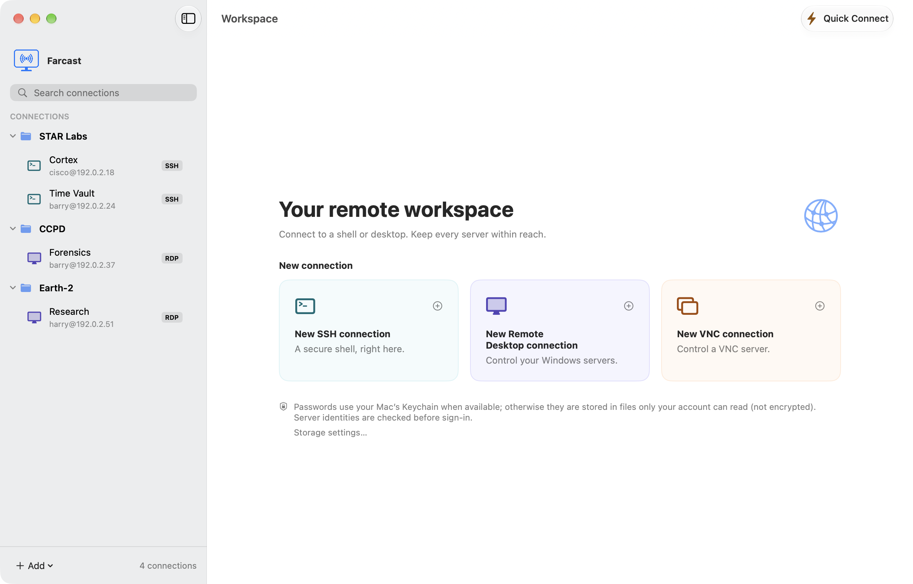
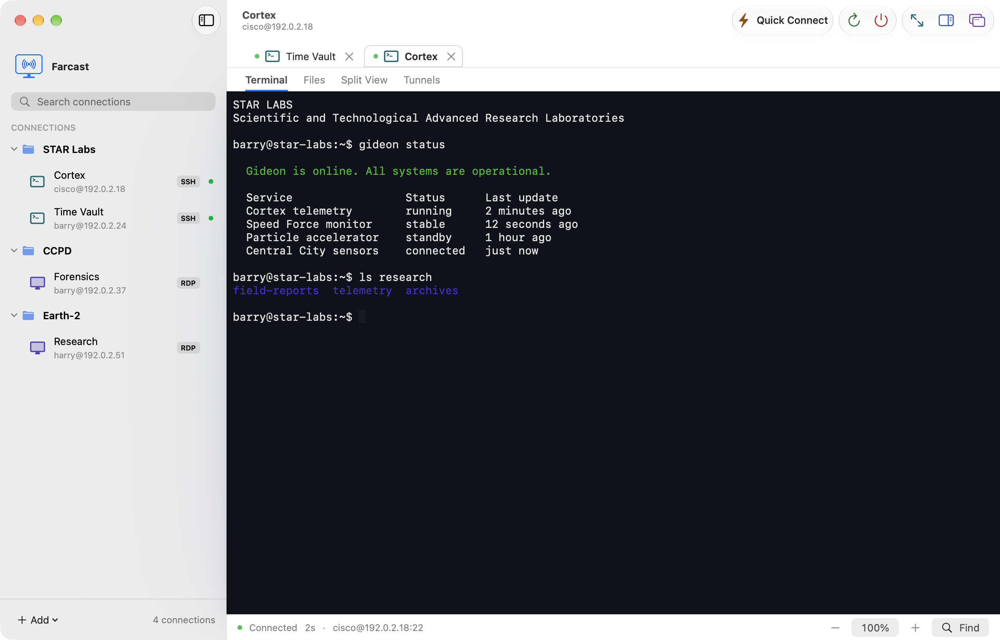
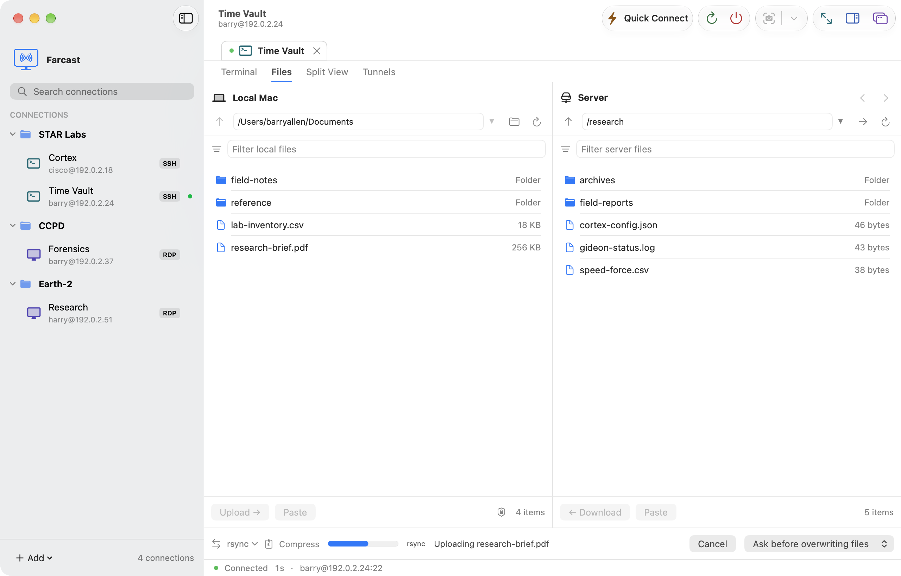
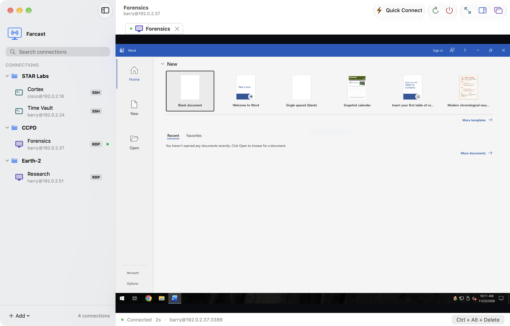
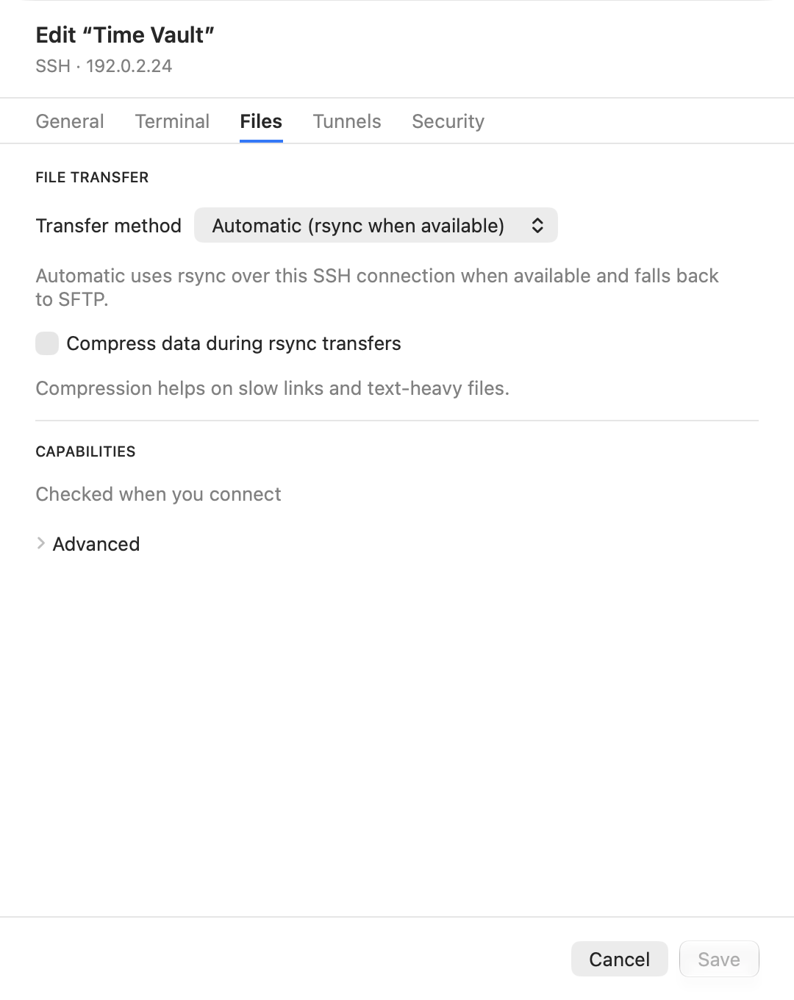

# Farcast

Farcast is a native Mac app for SSH terminals, file transfers, and RDP and VNC desktops. It runs on **Apple silicon with macOS 27 or later**.

- **Manage connections.** Organize hosts into folders, find a saved connection by name, or use Quick Connect. Switch between sessions in tabs or move one into its own window.
- **Work over SSH.** Use a terminal, forward ports, and drag files between your Mac and the server over the same login. File transfers prefer rsync with SFTP fallback. Keep browsing while a copy runs, or jump back to a recent folder.
- **Use a remote desktop.** Connect to Windows over RDP or to a VNC desktop. RDP supports optional clipboard and folder sharing.
- **Route through a VPN.** Assign a WireGuard or OpenVPN profile to a connection, or choose Connect Direct for a single session.
- **Capture a session.** Press **⇧⌘S** to save the visible terminal or desktop as PNG or JPEG, copy it to the clipboard, or both.

## Screenshots

**Connection library**

**SSH terminal and session tabs**

**File transfer over SSH**

**Windows desktop over RDP**

**Per-connection transfer settings**

## Install

Open the DMG and drag **Farcast.app** to **Applications**. Local builds are signed but unnotarized. If macOS blocks a copy you trust on first launch, open **System Settings → Privacy & Security → Open Anyway**, then confirm.

Saved credentials use Keychain when available, with an unencrypted local fallback. You can also choose a connection folder protected by a key file or password.

[User guide](docs/user-guide.md) · [Build from source](docs/development.md#build-from-source) · [Changelog](CHANGELOG.md) · [MIT license](LICENSE) · [Third-party licenses](ThirdParty/README.md)
