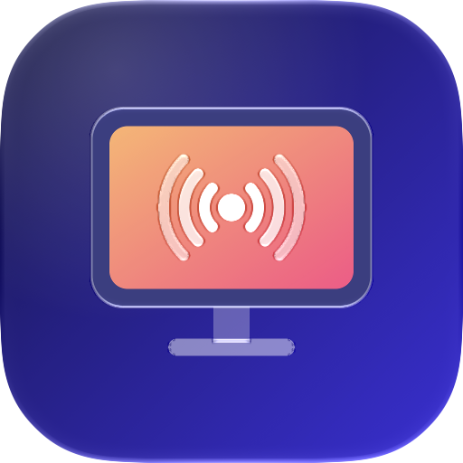
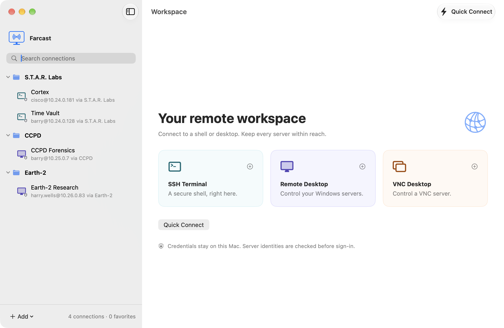
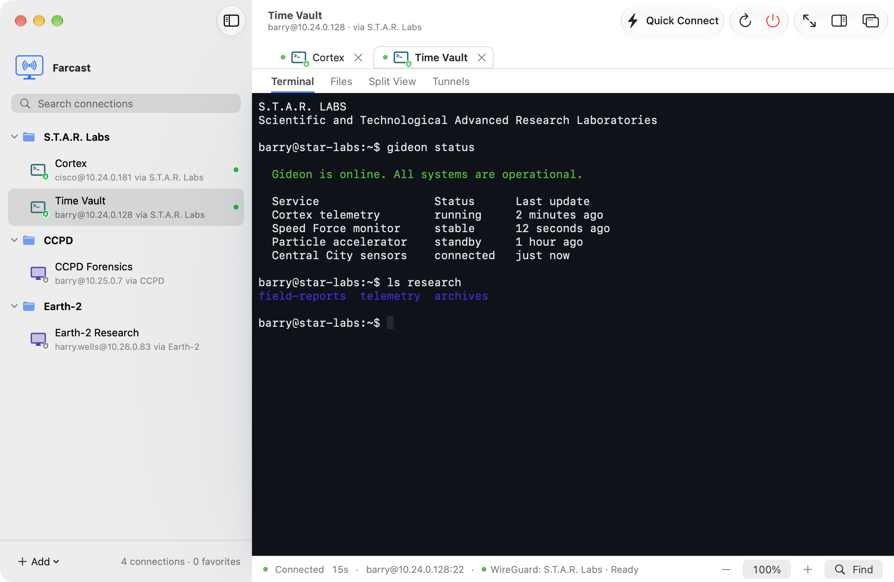
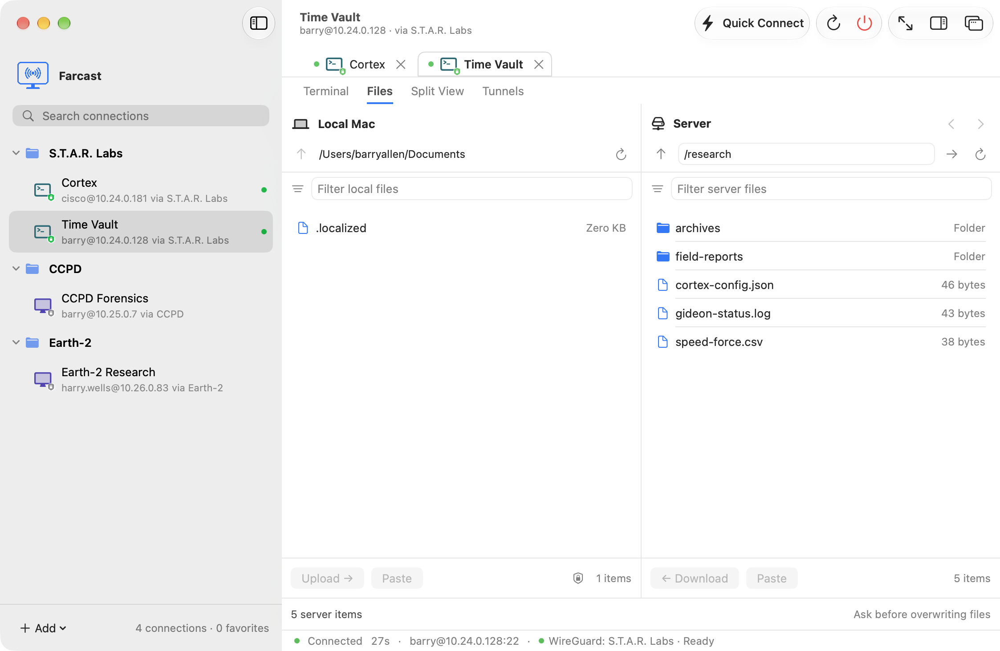
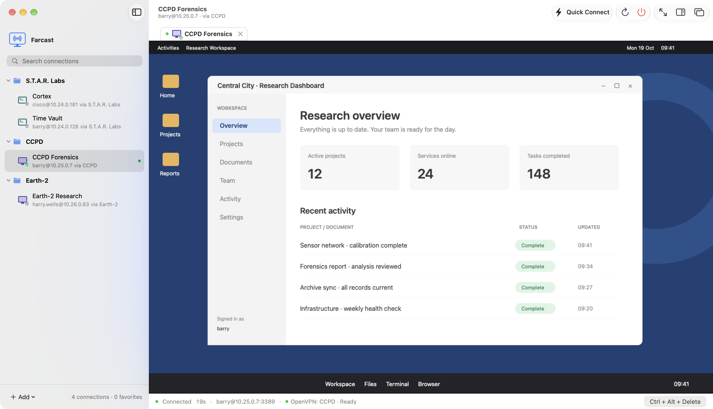
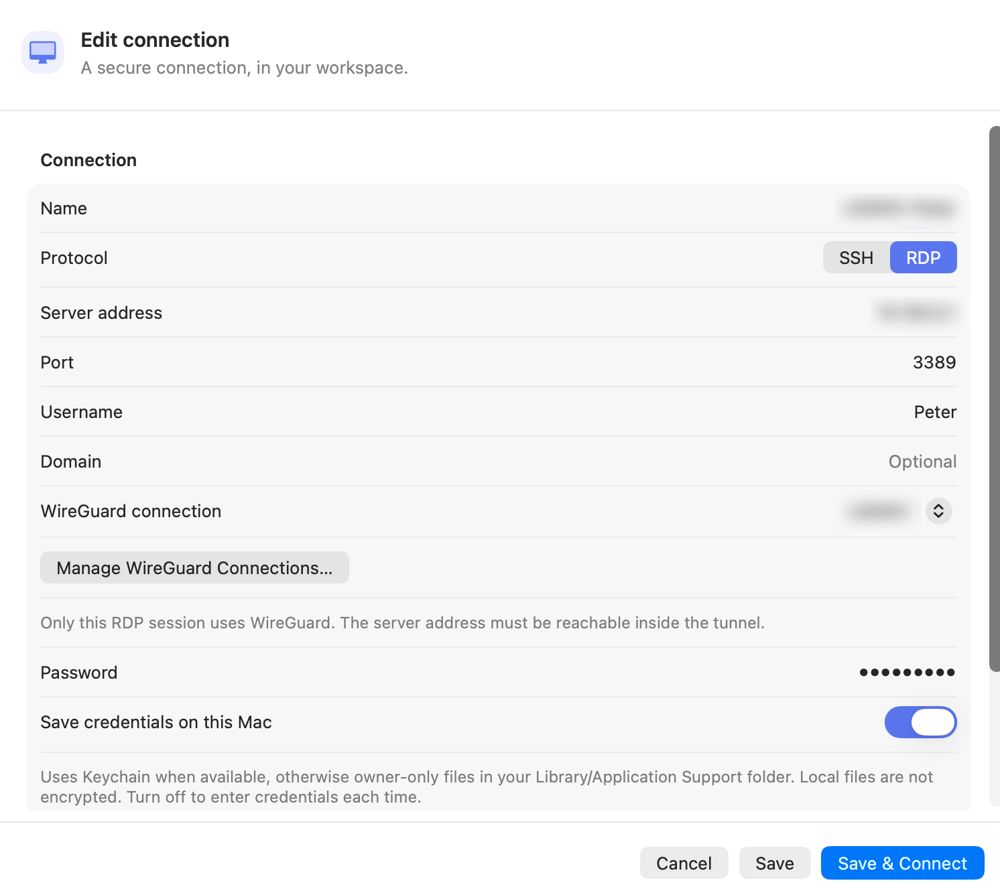

# Farcast



SSH terminals, SFTP files and RDP/VNC desktops in one native Mac app.
Includes saved connections, session tabs, SSH tunnels and optional shared WireGuard or OpenVPN for SSH, RDP and VNC.

Farcast is free and open source under the [MIT License](LICENSE): free to download,
use, modify and redistribute. Retain the copyright and license notice.
[Bundled dependencies](ThirdParty/README.md) retain their own licenses.

Requires **macOS 27+ and Apple silicon**. Protocol libraries are bundled.
Local builds are Apple Development signed and unnotarized.
Credentials use Keychain with an **unencrypted local fallback**, or an optional
connection folder with key-file/password AES-128 encryption or unencrypted files.

## Install and first launch

Farcast’s local delivery is signed but **not notarized**, so macOS may block its
first launch. Only approve a copy you trust.

1. Open the DMG and drag **Farcast.app** to **Applications**. For a source build,
   use the app path in [Build](#build) below.
2. Open Farcast once. If macOS blocks it because the developer cannot be verified
   or Apple cannot check it for malicious software, dismiss the alert without
   moving the app to the Trash.
3. Open **System Settings → Privacy & Security**, scroll to **Security**, and
   click **Open Anyway** beside the notice about Farcast. Try opening the app
   again if the notice is absent.
4. Authenticate when prompted, then click **Open** to confirm.

After this approval, open Farcast normally. See
[Apple’s first-launch instructions](https://support.apple.com/en-hk/102445).

## Screenshots



**SSH terminal**



**SFTP file transfer**



**Remote desktop**



**Connection editor**



## Build

With Xcode and the [build prerequisites](docs/development.md#build-from-source) installed:

```sh
scripts/prepare-dependencies.sh
scripts/build.sh
open ".build/Xcode/Build/Products/Release/Farcast.app"
```

[User guide](docs/user-guide.md) · [Development](docs/development.md) ·
[Agent guide](AGENTS.md) · [Architecture](docs/architecture.md) ·
[Testing](docs/testing.md) · [Known limits](docs/validation.md) ·
[Changelog](CHANGELOG.md) · [Dependencies & licenses](ThirdParty/README.md)
