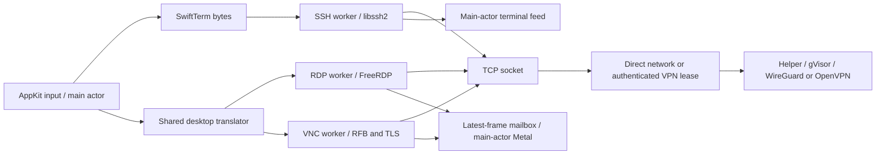

# Protocol stability review

Scope: validate the supplied checklist against this checkout and fix established
protocol/input defects. Preserve UI, supported features, security policy and data.
This is a focused source and regression review, not a complete security audit or
proof of production interoperability. The checklist's reported regression is a
hypothesis: no server-specific reproduction was supplied.

## Architecture and dependency inventory

| Path | Execution and ownership | Buffering/error delivery |
| --- | --- | --- |
| AppKit terminal → SwiftTerm → `FCSSHClient` → libssh2 → TCP or VPN lease | Main-actor terminal; one native worker owns shell, SFTP and forwarding channels. Session generation guards reject obsolete UI callbacks. | Ordered, bounded terminal writes; stable EAGAIN snapshots. Synchronous main-queue output delivery applies backpressure. Worker status callbacks return to the main actor. |
| AppKit desktop → scan codes/UTF-16/pointer → native queue → FreeRDP → TCP or VPN lease | Main-actor input and Metal surface; one native worker drains input and services FreeRDP. Session owns client, frames and presentation. | 4,096-event queue; consecutive motion coalesces; releases wait through reactivation. Latest-frame mailbox; transport failures feed bounded existing recovery. |
| AppKit desktop → X11 keysyms/RFB pointer → `FCVNCClient` → TCP/TLS or VPN lease | Shared main-actor desktop input; one worker owns socket, TLS and decoder. | 1 MiB input queue, bounded geometry/compressed data, exact reads/partial writes, next framebuffer request after each update. Worker failures surface through session status. |
| Session → shared VPN registry → pipe-controlled helper → gVisor TCP → WireGuard/OpenVPN → network | One helper/device per profile, one authenticated destination lease per session. Final lease/parent EOF ends helper; failure ends all leases. | Token-authenticated loopback listeners, route checks, bounded dialing/DNS, half-close relay and cancellation. No direct protocol fallback. |

Pinned sources: libssh2 `3209951db4e47ef902db047d12f9f464f835c27e`
(1.11.2_DEV), FreeRDP/WinPR 3.32.1, OpenSSL 3.6.5 and SwiftTerm 1.99.0.
Native adapters bridge through Objective-C/C; SwiftTerm uses Swift. The separate
Go helper uses wireguard-go `2631ce99a06f` and gVisor `39ed1f5ac29c`;
OpenVPN Core `1b4db00849bfb27e05c226cd13f6985527b6bb79` has an independent C++
bridge into the same helper/netstack. Full pins/licenses: `ThirdParty/README.md`
and `Networking/WireGuard/go.mod`.

## Regression analysis

- `08a46d6` changed modifier reconciliation, physical printable keys, focus cleanup,
  Caps synchronization and inactive RDP input retention. It is relevant to keyboard
  symptoms, but source history alone does not establish a regression.
- `88c26cd` changed initial RDP geometry negotiation; review must retain the
  desired/submitted/observed geometry contract and settled-size startup.
- `a36ad14` changed RDP timeout handling and pinned libssh2 to its security-fixed
  master snapshot. The PTY retry issue below follows libssh2's existing retained
  request packet contract; it does not establish a library regression.
- `3e1bea6`/`e8fe932` introduced/extended OpenVPN; `8c5bbd7` introduced VNC.
  SSH forwarding and SFTP already include partial-write and stable retry handling.
- Current project targets arm64/macOS 27, Swift language setting 5.0. An OS/Xcode
  upgrade cannot be inferred from these settings. No deterministic historical
  production failure is available for meaningful bisect or reference-client comparison.

## Findings and corrections

### P2 — SSH input queue silently drops overflow

Severity: High. Confirmed by deterministic boundary and authenticated owned-peer overflow
regressions. Location: `Farcast/Native/SSH/SSHClient.m:559`, `sendData:`.

Input exceeding the 1 MiB queue is silently discarded while the connection remains
usable. A large paste or backpressured session can execute incomplete command text.
Retain the bound and fail the transport explicitly on overflow, using the existing
failure/status path. Never deliver later input after the gap. Risk: an overloaded
session now disconnects visibly instead of continuing with missing bytes.

### P1 — final SSH terminal size can disappear under backpressure

Severity: Medium. Confirmed by source reasoning and deterministic regression. Location:
`Farcast/Native/SSH/SSHClient+Terminal.m:40`, resize block in `pumpTerminal:`;
`SSHClient.m`, `resizeColumns:rows:`.

libssh2 retains its first window-change packet across EAGAIN. The adapter rereads
the newest dimensions on every retry. If the user resizes again before the old
packet succeeds, the adapter can clear the new pending dimensions although the
server received the old packet. Full-screen terminal programs then use stale
rows/columns. Retain submitted dimensions until completion, and only clear the
pending request if they still match the desired dimensions. Propagate fatal resize
errors. Risk: limited to the existing worker's resize bookkeeping.

### P3 — forwarded Command key equivalents can leave a nonmodifier held

Severity: Medium. Confirmed by owned AppKit event regression. Location:
`Farcast/Protocols/RDP/RDPDesktopView.swift:637`, `performKeyEquivalent(with:)`
and physical pressed-key bookkeeping.

The handler forwards nonlocal Command combinations as physical key-down and waits
for ordinary key-up. AppKit may omit that key-up while Command is held. Releasing
Command reconciles modifiers but leaves the other remote key held until focus loss.
Balance physical key-down with key-up in the forwarded Command-equivalent path;
repeat key-down events remain individual taps. Apply to shared RDP/VNC input without
changing which shortcuts are local or remote. Risk: limited to forwarded Command
combinations, which cannot reliably represent held nonmodifier keys on macOS.

### P4 — failed RDP input sends are discarded without ending the transport

Severity: Medium. Confirmed by injected FreeRDP callback-failure regressions against the owned
TLS/NLA peer. Location: `Farcast/Native/RDP/RDPClient.m:703`, `drainEvents:`.

The queue is cleared before sends; Boolean results from keyboard, Unicode,
synchronize and pointer APIs are ignored. A failed send can discard a release while
the adapter continues reporting connected. Stop the drain on the first failure,
mark transport failure and use existing teardown/recovery. Do not retry an uncertain
input write, which could duplicate input. Risk: uses the existing bounded recovery
policy after a genuine input transport failure.

## Checklist disposition and remaining limits

| Checklist | Assessment |
| --- | --- |
| Concurrency, FFI, teardown | Native handles stay on protocol workers; cancellation interrupts sockets, generation checks protect main-actor callbacks. SSH output deliberately blocks its worker until the main actor consumes bytes, bounding rendering backlog. Keychain prompt stalls remain documented; unrelated credential/UI refactoring is excluded. |
| Socket correctness | Existing partial I/O, EINTR/EAGAIN, exact framing, SO_NOSIGPIPE and TCP_NODELAY paths apply. Blocking worker DNS and physical network/sleep transitions need live timing validation; source review cannot certify them. |
| Keyboard | Existing focus releases, side-specific modifiers, Caps synchronization, IME/UTF-16 pairs and local shortcut rules already cover much of the checklist. P3 closes a remaining Command-key gap. Option stays remote Alt; adding a Meta preference or new layout/key support is outside scope. |
| Mouse | Existing inverse framebuffer transforms, letterboxing, stale-size checks, drag-release fallback and fractional vertical wheel encoding apply. RDP negative wheel values already use signed nine-bit encoding. Horizontal scrolling/extra-button support would be features, not fixes to add here. |
| SSH/SFTP/forwarding | One authenticated session, modern pinned libssh2, stable terminal/SFTP/forwarding writes, bounded channels/flows and half-close handling. P1/P2 address confirmed gaps. `libssh2_channel_eof` masks EOF while channel data remains queued, so the suggested lost-tail diagnosis does not apply. Agent, ProxyJump and SCP are unsupported. |
| RDP | FreeRDP owns handshake, NLA, decoding, virtual-channel framing and autodetect responses. GFX/H.264 is disabled; missing GFX frame acknowledgements are not an applicable explanation. No app output-suppression path was found. Dynamic resize requires Display Control; server-observed geometry stays authoritative. P4 addresses discarded send failures. |
| VNC | Independent RFB implementation supports 3.3/3.7/3.8, password/no-auth and selected X509 VeNCrypt modes; bounded Raw/CopyRect/Hextile/Zlib and DesktopSize. ZRLE/Tight, ARD, cursor/audio/file channels are unsupported. Idle loop does not impose the partial-message 30-second deadline on a quiet desktop. |
| VPN | wireguard-go owns handshake/rekey/keepalive; gVisor owns tunneled TCP. Ready means destination lease availability, not a continuously verified peer handshake. This is documented, not evidence of a false completed handshake claim. Endpoint refresh on reconnect and production roaming/MTU/blackhole behavior remain known limits. No new diagnostics UI or routing-policy changes. |
| Platform/testing | Existing sandbox/signing and lifecycle checks apply. Sanitizers, Instruments, physical sleep/wake, packet-loss/MTU and long production sessions provide different evidence from fixtures; none should be claimed without running them. No system network conditioner/firewall changes or real desktop input are needed for these fixes. |

No maintainer decision blocks the confirmed fixes. Future layout, Option/Meta,
horizontal-wheel, sleep/wake recovery or diagnostics work requires separate scope.
Preserve trust checks, supported algorithms and library pins.

## Static analyzer triage

Clang analysis ran over all owned SSH/RDP/VNC Objective-C implementation files.
It reported eight warnings, not eight established runtime defects:

- `SSHClient+Forwarding.m:150` and `:330`: unchecked return from `numericAddress`
  at local call sites. Current rule creation validates numeric bind strings before
  storing them, and the bundle probe uses literal loopback addresses. No invalid
  reachable bind was established; IPv4/IPv6 listener/forwarding fixtures pass.
- `SSHClient+Forwarding.m:573`: analyzer cannot prove a streaming flow has a valid
  socket. Socket closure transitions to closing; accepted/connected streams own a
  descriptor. No negative-descriptor stream reproduced.
- `SSHClient+Forwarding.m:724`: analyzer models undefined errno after an arbitrary
  method failure. Current listener failures follow socket/bind/listen/getsockname;
  no stale-errno functional failure was established.
- `SSHClient+Terminal.m:31` and `VNCClient.m:739`, `:747`, `:752`: dead stores before
  an unconditional exit. These do not change protocol behavior and are left alone.

The forwarding warnings are source-reviewed, unconfirmed diagnostic concerns,
not sanitizer findings or an assertion that these paths are proven safe under
all future changes. No drive-by warning suppression or refactoring was added.

## Verification

The full [129-item disposition](docs/protocol-review-checklist.md) retains each
original checklist bullet, its assessment and the reason for any incomplete work.

- P1/P2: `scripts/test-ssh.sh`, including deterministic PTY EAGAIN/final-size,
  fatal-resize, stable partial-write, exact-capacity/overflow checks and an
  authenticated overflow session reporting failure.
- P3: `scripts/test-rdp-keyboard.sh`, including omitted key-up, repeated Command
  equivalents, late key-up deduplication and existing native focus/IME/geometry checks.
- P4: `scripts/test-rdp.sh` and `scripts/test-rdp-nla.sh`, with separate injected
  keyboard, Unicode, synchronize and pointer failures. Each stops on the first
  failed event, surfaces failure and remains eligible for existing bounded recovery.
- Targeted AddressSanitizer/UndefinedBehaviorSanitizer execution passes for the
  deterministic SSH regression, not the entire app or third-party libraries.
- Core Swift tests, maintenance tests, repository hygiene, owned SSH forwarding,
  SFTP and VNC suites pass. Go race tests and `go vet` pass; native analysis results
  are triaged above. Release compilation succeeds; the AppIntents metadata tool
  emits its existing no-AppIntents-dependency notice. The standalone audio fixture
  also emits two deprecation warnings from unchanged WinPR headers.
- The signed Release bundle passes loader, arm64/macOS target, library-closure,
  embedded helper/listener and certificate-continuity verification. Version stays
  2.0.1; the single app build advances 31 → 32.
- Authorized read-only real-server probes reject enabled entries at input
  validation (invalid entry or missing required SSH fingerprint). No server
  connection pass is claimed; trust requirements were not bypassed.

- `scripts/test-workspace.sh` passes owned session/tab/prompt/quit, terminal
  mouse/paste, detached/full-screen presentation and bounded reconnect checks.
  Actual macOS full-screen returns preserve new frames and input without test redraws.
- `scripts/test-wireguard-sessions.sh` passes concurrent production SSH/SFTP/RDP/VNC
  sessions against encrypted owned peers under Go race detection.
- `scripts/test-rdp-health.sh`, `scripts/test-rdp-drives.sh`,
  `scripts/test-rdp-files.sh` and `scripts/test-rdp-audio.sh` pass.
  The clipboard harness reports a sandbox-extension diagnostic while its owned
  private-pasteboard assertions pass; this is not production Finder grant proof.
- `scripts/test-live-fixtures.sh` passes redacted protected-input and owned-server
  probe checks. This is separate from the rejected real-server configuration.

Delivery packages the verified Release bundle without rebuilding. The packaging
script verifies the mounted bundle and emits its SHA256 sidecar.
No full-app TSan/Zombies/Instruments or physical sleep/roaming/blackhole/server-layout
matrix is claimed. UI layout, controls, styling, supported features and shortcut
routing remain unchanged; only confirmed faulty protocol/input behavior is corrected.
